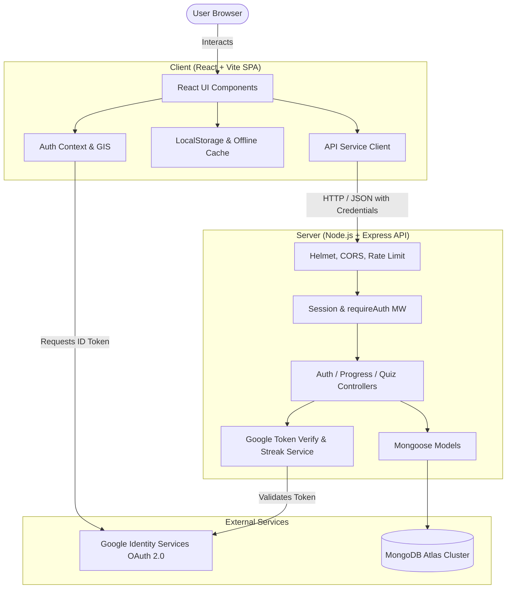
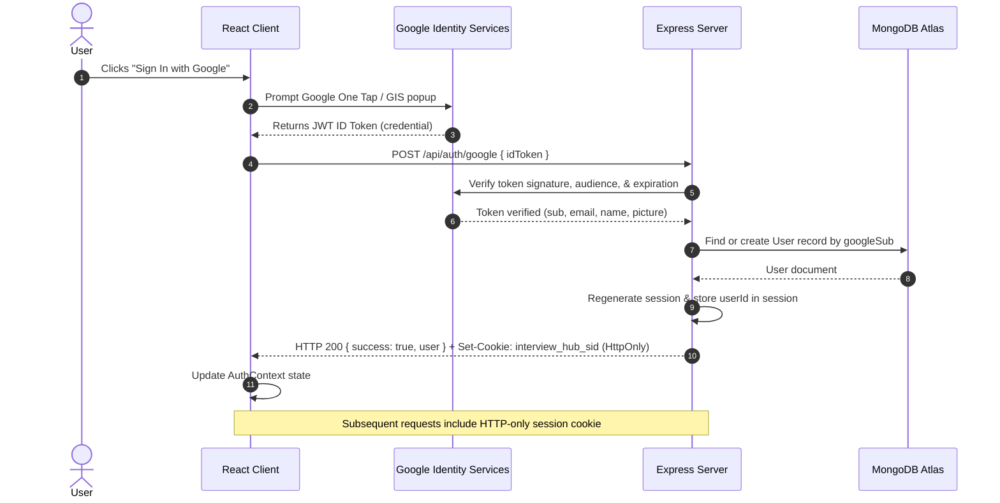

# Architecture & System Design

This document details the software architecture, system boundaries, data models, authentication flows, and security design of the **Interview Hub** full-stack technical interview preparation platform.

---

## 1. System Overview

Interview Hub is architected as a decoupled full-stack application composed of:
1. **Client (`client/`)**: A Single Page Application (SPA) built with React 18 and Vite.
2. **Server (`server/`)**: A RESTful API built with Node.js, Express, and MongoDB Atlas.



---

## 2. Directory Responsibilities

### Client (`client/`)
- **`public/`**: Static assets served directly (favicons, manifest).
- **`src/assets/`**: Bundled assets and media.
- **`src/components/`**: Reusable presentation components:
  - `common/`: Badges, progress bars, empty states, search modals.
  - `layout/`: Top navigation, layout wrapper, persistent layout shell.
  - `navigation/`: Header and sidebar menus.
  - `markdown/`: Code syntax highlighters and Table of Contents viewers.
  - `practice/`: Interactive cards for MCQs, Flashcards, Coding, and Mock Interviews.
  - `auth/`: Google SSO login modal, protected route guards, user profile popover.
- **`src/pages/`**: Primary application views (Dashboard, Subjects, Learn/StudyMaterial, Questions, MCQs, Flashcards, Bookmarks, Progress, Settings).
- **`src/content/`**: 15 categorized technical curriculum domains in Markdown:
  - `programming/`, `dsa/`, `dbms/`, `sql/`, `linux/`, `aws/`, `devops/`, `docker/`, `kubernetes/`, `networking/`, `operating-systems/`, `web-development/`, `terraform/`, `devsecops/`, `system-design/`.
- **`src/data/`**: Canonical interview questions, MCQs, flashcards, coding problems, and SQL challenges.
- **`src/context/`**: React contexts (`AuthContext.jsx`) managing Google Identity Services lifecycle and session state.
- **`src/hooks/`**: Custom hooks (`useAuth`, `useProgress`, `useSearch`, `useLocalStorage`).
- **`src/services/`**: Network communication abstraction (`api.js`, `authService.js`).
- **`src/utils/`**: Markdown frontmatter parser, content indexing, and offline storage fallbacks.

### Server (`server/`)
- **`src/config/`**: Database connection lifecycle (`database.js`) with automatic fallback to local mode when offline.
- **`src/models/`**: Mongoose schemas:
  - `User.js`: User profile, Google subject ID, streak counters, study milestones, preferences.
  - `QuizAttempt.js`: Validated MCQ quiz scores and timestamped history.
  - `StudyActivity.js`: Activity logs for streak computation and heatmap visualization.
- **`src/controllers/`**: HTTP request handlers (`authController`, `userController`, `progressController`, `quizController`).
- **`src/middleware/`**:
  - `requireAuth.js`: Rejects unauthenticated requests with HTTP 401.
  - `errorHandler.js`: Centralized error logging and safe sanitization of exceptions.
- **`src/validators/`**: Request schema validation powered by `express-validator`.
- **`src/services/`**:
  - `googleAuthService.js`: Server-side verification of Google ID tokens against client ID.
  - `streakService.js`: Dynamic timezone-aware study streak computation.
  - `dataService.js`: Database queries and data access layer.
- **`src/app.js`**: Express application factory mounting middleware, security configurations, and routes.
- **`src/server.js`**: Application entrypoint initializing database connection and listening on configured port.
- **`tests/`**: Native Node.js test runner suite (`auth_and_api.test.js`).

---

## 3. Authentication & SSO Flow

Authentication uses Google Identity Services (GIS) with server-side token verification and secure HTTP-only cookie sessions.



### Security Details of the Auth Flow
1. **No Tokens in Client Storage**: Google ID tokens are never stored in `localStorage` or `sessionStorage`.
2. **Session Hijacking Mitigation**: Sessions are stored in HTTP-only, `SameSite=Lax` cookies that JavaScript cannot access.
3. **Session Fixation Protection**: The backend calls `req.session.regenerate()` immediately upon successful authentication.
4. **Offline Resilience**: When unauthenticated, users have full access to study materials. Progress is cached locally in `localStorage` and can be synchronized upon sign-in.

---

## 4. Data Models

### User Schema (`server/src/models/User.js`)
```typescript
interface User {
  googleSub: string;        // Unique Google Subject identifier (indexed)
  email: string;            // User email address (lowercase, indexed)
  name: string;             // Display name
  picture?: string;         // Avatar URL
  role: 'user' | 'admin';
  preferences: {
    theme: 'dark' | 'light' | 'system';
    emailNotifications: boolean;
    dailyGoalMinutes: number;
  };
  streak: {
    currentStreak: number;
    longestStreak: number;
    lastActivityDate: string; // YYYY-MM-DD in UTC
    totalActivities: number;
  };
  progress: {
    completedLessons: string[];
    bookmarks: Array<{ contentId: string; type: string; createdAt: Date }>;
    flashcards: Map<string, 'mastered' | 'reviewing' | 'unseen'>;
  };
  createdAt: Date;
  updatedAt: Date;
}
```

### QuizAttempt Schema (`server/src/models/QuizAttempt.js`)
```typescript
interface QuizAttempt {
  user: ObjectId;           // Ref: User (indexed)
  subject: string;          // Curriculum domain (e.g., 'oop', 'dsa')
  score: number;            // Validated score
  totalQuestions: number;
  passed: boolean;          // score / total >= 0.7
  completedAt: Date;
}
```

---

## 5. REST API Specifications

| Method | Endpoint | Auth Required | Description |
|---|---|:---:|---|
| `GET` | `/api/health` | No | Health check, service status, database connectivity |
| `POST` | `/api/auth/google` | No | Verify Google ID token and establish session |
| `GET` | `/api/auth/me` | No | Fetch active session user profile or unauthenticated status |
| `POST` | `/api/auth/logout` | No | Invalidate active session and clear cookie |
| `GET` | `/api/users/me` | **Yes** | Retrieve authenticated user profile |
| `PATCH` | `/api/users/me/preferences`| **Yes** | Update user preferences |
| `GET` | `/api/progress` | **Yes** | Retrieve all user study progress |
| `PUT` | `/api/progress` | **Yes** | Bulk sync offline progress to MongoDB |
| `POST` | `/api/progress/lessons/:id/complete` | **Yes** | Mark lesson as completed |
| `POST` | `/api/progress/lessons/:id/uncomplete` | **Yes** | Unmark completed lesson |
| `POST` | `/api/progress/bookmarks` | **Yes** | Add bookmark |
| `DELETE` | `/api/progress/bookmarks/:id` | **Yes** | Remove bookmark |
| `PUT` | `/api/progress/flashcards/:id` | **Yes** | Update flashcard mastery status |
| `GET` | `/api/progress/dashboard` | **Yes** | Compute active streak and aggregate metrics |
| `POST` | `/api/progress/activity` | **Yes** | Record study activity for streak computation |
| `POST` | `/api/quizzes/attempts` | **Yes** | Record verified MCQ attempt |
| `GET` | `/api/quizzes/history` | **Yes** | Paginated quiz attempts history |

---

## 6. Security Architecture

1. **Helmet**: Protects HTTP responses with standard security headers (X-Frame-Options, X-Content-Type-Options, Strict-Transport-Security).
2. **CORS Whitelist**: Origin checking restricts cross-site requests to configured development and production domains (`ALLOWED_ORIGINS`).
3. **Session Cookies**:
   - `httpOnly: true` — Blocks client JavaScript access.
   - `sameSite: 'lax'` — Prevents CSRF on cross-site requests.
   - `secure: true` in production environments (requires HTTPS).
4. **Rate Limiting**: `express-rate-limit` prevents brute-force login attempts and API abuse.
5. **Scoped Database Access**: All mutating endpoints extract user identity strictly from `req.session.userId`, preventing horizontal privilege escalation.
